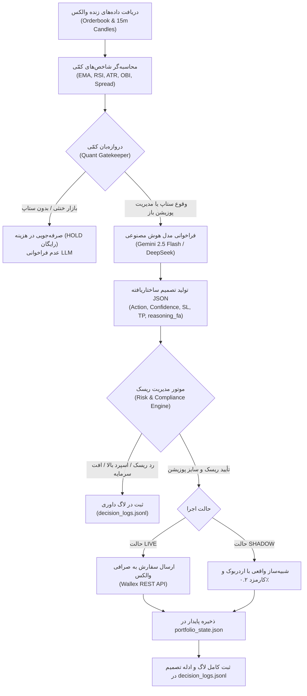

# موتور معاملاتی هوشمند اسپات والکس (Wallex Agentic AI Spot Trader)
### هکاتون Agentic AI استارکوچ - چالش اختصاصی صرافی والکس

---

## ۱. نمای کلی پروژه و تطابق با معیارهای داوری (۳۰۰ امتیاز)

این پروژه یک موتور معاملاتی هوشمند (Algorithmic Trading Agent) مستقل و سازمانی برای بازار اسپات صرافی والکس است که با سرمایه اولیه **۵ میلیون تومان (5,000,000 TMN)** و با هدف بیشینه‌سازی سود محقق‌شده تومانی (Realized TMN Return) با کنترل سخت‌گیرانه ریسک (افت سرمایه کمتر از ۳.۵٪) طراحی شده است.

### تطابق با جدول امتیازدهی داوری:
1. **بخش اول: عملکرد معاملاتی (۱۵۰ امتیاز)**
   - **سود نهایی (۹۰ امتیاز):** استراتژی شکار بازگشت‌ها و روندهای تومانی با خروج سریع در سود (+۲.۲٪) و تبدیل ۱۰۰٪ دارایی‌ها به تومان نقد در پایان هکاتون.
   - **کنترل ضرر (۳۰ امتیاز):** حد ضرر سخت‌گیرانه ۱.۲٪ روی هر معامله، سیستم حد ضرر متحرک (Trailing Stop)، و مدارشکن کلی (Circuit Breaker) در صورت افت ۳.۵٪ از سقف سرمایه.
   - **فعال بودن الگوریتم (۱۵ امتیاز):** اسکن مداوم جفت‌ارزهای نقدشونده تومانی و انجام معاملات منظم الگوریتمی در طول ۴۸ ساعت.
   - **پایداری اجرا (۱۵ امتیاز):** فرمت‌بندی دقیق اعشار قیمت و حجم (tickSize/stepSize)، مدیریت تایم‌اوت، حذف سفارش‌های تاریخ‌گذشته، و صفر بودن خطاهای ارسال سفارش.

2. **بخش دوم: کیفیت فنی و تکرارپذیری (۱۵۰ امتیاز)**
   - **منطق استراتژی (۴۰ امتیاز):** همگرایی تکنیکال و ساختار عمق اردربوک (OBI + RSI + EMA + Spread).
   - **استفاده واقعی از AI (۳۵ امتیاز):** مدل هوش مصنوعی (Gemini 2.5 Flash / DeepSeek V3) مستقیماً داده‌های ساختاریافته را تحلیل کرده و در قالب خروجی استاندارد JSON سیگنال و تحلیل فارسی ارائه می‌دهد (نه شرط‌های صوری If/Else).
   - **مدیریت ریسک و سرمایه (۳۰ امتیاز):** سقف ۲۲٪ حجم روی هر پوزیشن، حفظ حداقل ۲۰٪ پول نقد در حساب، و محدودیت حداکثر ۳ پوزیشن همزمان.
   - **قابلیت اجرای مجدد (۲۵ امتیاز):** ساختار ماژولار، فایل کانفیگ `.env`، مدیریت ذخیره‌سازی وضعیت در `portfolio_state.json`.
   - **بکتست و تست سایه (۲۰ امتیاز):** ماژول مجزای `backtest_engine.py` با داده‌های تاریخی والکس و تست سایه زنده (`SHADOW`) با قیمت‌های لحظه‌ای اردربوک و کارمزد ۰.۲٪.

---

## ۲. معماری سیستم و تکنیک دروازه‌بان کمّی (Quant Gatekeeper)

برای حل مشکل هزینه بالا و محدودیت سقف درخواست (Rate Limit) مدل‌های زبانی در طول ۴۸ ساعت، معماری دو‌مرحله‌ای پیاده‌سازی شده است:



---

## ۳. پاسخ به ۳ چالش کلیدی پایداری و مدیریت ریسک

### ۱) قفل شدن پول در سفارش‌های لیمیت پرنشده (Stale Limit Orders)
- **مشکل:** اگر سفارش LIMIT ثبت شود ولی قیمت فرار کند، سرمایه تومانی تیم در حالت `locked` حبس می‌شود و فرصت‌های معاملاتی بعدی از دست می‌روند.
- **راهکار ما:** متد خودکار `clean_stale_limit_orders()` پیاده‌سازی شده که به صورت خودکار هر ۳ دقیقه (۱۸۰ ثانیه) سفارش‌های لیمیت باز را شناسایی کرده و لغو می‌کند تا نقدینگی فوراً آزاد شود.

### ۲) پایداری وضعیت در صورت ری‌استارت اسکریپت (Crash Resilience)
- **مشکل:** قطع شدن اینترنت، ریبوت سرور یا خطاهای غیرمنتظره می‌تواند قیمت ورود، حد ضرر و وضعیت پوزیشن‌های باز را پاک کند.
- **راهکار ما:** فایل `portfolio_state.json` با متد ذخیره اتمی (Atomic Write) تمام پوزیشن‌های باز، بالاترین قیمت دیده‌شده (Peak Price)، حد ضرر متحرک و سقف سرمایه (`peak_equity_tmn`) را ذخیره می‌کند و در ابتدای اجرای اسکریپت آن را با موجودی واقعی والکس همگام (Sync) می‌سازد.

### ۳) تست سایه (Shadow Mode) واقعی با داده‌های زنده و کارمزد
- **مشکل:** تست‌های دمو و تئوریک بدون احتساب اسپرد و کارمزد نتایج گمراه‌کننده دارند.
- **راهکار ما:** ماژول `shadow_simulator.py` دقیقاً با داده‌های عمق لحظه‌ای والکس (`/v1/depth`) قیمت سرخط خرید و فروش (`best_bid` / `best_ask`) را محاسبه کرده، کارمزد واقعی ۰.۲٪ را کسر می‌کند و لاگ‌هایی کاملاً مشابه محیط واقعی برای داوران تولید می‌نماید.

---

## ۴. لیست بازارهای ممنوعه و تطابق کامل با قوانین هکاتون

طبق داکیومنت رسمی هکاتون، معامله روی **۳۲۶ بازار مشخص‌شده** به طور قطعی ممنوع است. همچنین تمام سود و زیان تیم باید بر پایه تومان (TMN) محقق شود و هیچ دارایی رمزارزی نباید در پایان چالش به صورت کوین باقی بماند.

- **ماژول `market_compliance.py`:**
  - شامل مجموعه کامل ۳۲۶ بازار ممنوعه.
  - اعمال متد `assert_market_allowed()` قبل از هرگونه تحلیل یا ثبت سفارش.
  - فیلتر خودکار جفت‌ارزها و محدودسازی به بازارهای پرنقدینگی تومانی:
    - `BTCTMN`, `ETHTMN`, `SOLTMN`, `XRPTMN`, `USDTTMN`, `DOGETMN`, `BNBTMN`, `TRXTMN`
- **نقدسازی خودکار در پایان چالش (`check_contest_deadline_and_flatten`):**
  - ۲۵ دقیقه قبل از ساعت پایان رسمی هکاتون، ربات به صورت خودکار کلیه دارایی‌های کریپتویی را با سفارش MARKET به تومان نقد تبدیل می‌کند تا بازدهی ۱۰۰٪ به صورت سود محقق‌شده تومانی ثبت گردد.

---

## ۵. راهنمای نصب و راه‌اندازی (ویژه داوران)

### نیازمندی‌ها
- پایتون ۳.۱۰ یا بالاتر

### گام اول: نصب وابستگی‌ها
```bash
pip install -r requirements.txt
```

### گام دوم: تنظیم متغیرهای محیطی
یک کپی از فایل `.env.example` با نام `.env` بسازید:
```bash
cp .env.example .env
```
محتویات `.env`:
```ini
WALLEX_API_KEY="کلید_حساب_چالش_شما"
EXECUTION_MODE="SHADOW"  # حالت SHADOW یا LIVE

# اتصال به مدل هوش مصنوعی (ارزان و سریع)
LLM_API_KEY="کلید_API_جمینای_یا_اوپن_روتر"
LLM_BASE_URL="https://generativelanguage.googleapis.com/v1beta/openai/"
LLM_MODEL="gemini-2.5-flash"
```

### گام سوم: اجرای بکتست (Backtesting)
برای بررسی عملکرد الگوریتم روی داده‌های تاریخی بازار والکس:
```bash
python backtest_engine.py BTCTMN
```

### گام چهارم: اجرای ربات معاملاتی (حالت سایه یا زنده)
```bash
python main.py
```

---

## ۶. لاگ تصمیمات برای داوری فنی (decision_logs.jsonl)

برای هر تصمیم، یک رکورد ساختاریافته در `decision_logs.jsonl` ثبت می‌شود که شامل مشخصات بازار، شاخص‌ها، سیگنال‌ها و توضیح فنی دقیق به زبان فارسی است:

```json
{
  "timestamp": "2026-10-22T11:05:00+00:00",
  "mode": "SHADOW",
  "symbol": "BTCTMN",
  "action": "BUY",
  "order_type": "LIMIT",
  "ai_confidence": 0.82,
  "signals_observed": ["TREND_PULLBACK_WITH_POSITIVE_OBI", "RSI=44.2", "OBI=+0.21"],
  "reasoning_fa": "تأیید همگرایی روند صعودی با اصلاح RSI به ۴۴.۲ و عدم تعادل مثبت در دفتر سفارشات (OBI برابر ۰.۲۱) که برتری خریداران را در سرخط عمق نشان می‌دهد. حد ضرر در ۲۱,۴۵۰,۰۰۰ تومان (۱.۲٪) و هدف سود در ۲۲,۴۰۰,۰۰۰ تومان (+۲.۲٪) تنظیم شد.",
  "market_snapshot": {
    "last_price": 21919254,
    "best_bid": 21915000,
    "best_ask": 21930000,
    "spread_pct": 0.07,
    "obi_top5": 0.214,
    "rsi_14": 44.2,
    "atr_14": 185000
  },
  "risk_verdict": "Approved by Risk Engine",
  "execution_result": {
    "status": "FILLED",
    "executed_price": 21915000,
    "notional_tmn": 1100000,
    "fee_tmn": 2200
  }
}
```
