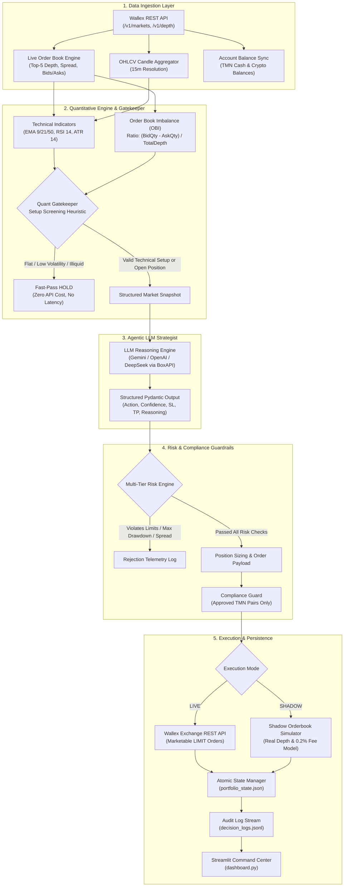

# Wallex Autonomous Agentic AI Spot Trading Engine

An enterprise-grade, fully autonomous algorithmic trading engine designed for the Wallex cryptocurrency spot exchange. The system bridges quantitative market microstructure analytics (Order Book Imbalance, Multi-Timeframe EMAs, RSI, ATR) with large language model (LLM) reasoning and an institutional-grade risk management framework.

The engine operates in two interchangeable modes:
- **`LIVE`**: Executes real spot orders on Wallex via authenticated REST APIs with strict precision formatting, marketable limit orders, and automatic orderbook tracking.
- **`SHADOW`**: A high-fidelity paper trading simulator that queries live Wallex orderbooks in real time, factoring in realistic slippage, depth consumption, and taker exchange fees (0.2%–0.3%) with zero financial risk.

---

## 1. System Architecture & Information Flow

The architecture follows a modular, decoupled pipeline designed for high resilience, low execution latency, and deterministic risk boundaries:



---

## 2. Core Subsystems & Design Patterns

### 2.1 Dual-Cadence Orchestration (`main.py`)
The trading engine runs an event-driven loop featuring two distinct cadences:
1. **Fast Position Check (every 4 seconds):** Monitors unrealized PnL, hard stop-loss levels, and dynamic trailing stop triggers for all currently open positions. If an exit threshold is breached, execution fires immediately without waiting for a full market scan.
2. **Full Market Scan Cycle (every 45 seconds):** Iterates over all active, compliant TMN pairs, computes technical indicators, runs setup screening, queries the LLM when justified, and evaluates new entry signals.

### 2.2 Quant Engine & Gatekeeper Heuristic (`quant_engine.py`)
To prevent excessive API costs and eliminate rate-limit bottlenecks across 24/7 continuous runs, the engine implements a two-stage **Quant Gatekeeper**:
- **Microstructure Indicators:** Computes real-time Order Book Imbalance (OBI) on top-5 book levels:
  $$\text{OBI} = \frac{\sum Q_{\text{bid}} - \sum Q_{\text{ask}}}{\sum Q_{\text{bid}} + \sum Q_{\text{ask}}}$$
- **Trend & Volatility Filters:** Evaluates multi-period Exponential Moving Averages (EMA 9, 21, 50), Relative Strength Index (RSI 14), and Average True Range (ATR 14).
- **Gatekeeper Screening:** The LLM is only invoked when either:
  1. A symbol has an active open position requiring management/exit reasoning.
  2. The market shows an actionable setup (e.g., trend pullback into support, oversold RSI reversal, positive orderbook imbalance, and narrow bid-ask spread).
  *Result: Over 80% of quiet/unviable cycles are filtered out locally with zero latency and zero LLM cost.*

### 2.3 Agentic LLM Strategist (`llm_strategist.py`)
- Employs structured JSON schema enforcement via Pydantic (`TradingDecision`).
- Evaluates market regime, orderbook depth imbalance, risk/reward profiles, and current portfolio equity.
- Returns deterministic trading actions (`BUY`, `SELL`, `HOLD`), recommended stop-loss/take-profit prices, confidence scores (0.0 to 1.0), and natural language technical rationales.
- Features automatic fallbacks: Any parsing anomaly, timeout, or schema mismatch safely degrades to a conservative `HOLD` action.
- Built-in throttling delays repeated calls on unchanged neutral positions.

### 2.4 Multi-Tier Risk Management (`risk_manager.py`)
The engine enforces non-negotiable capital preservation rules:
- **Maximum Capital per Trade:** Capped at 20%–22% of total portfolio equity.
- **Cash Reserve Floor:** Maintains a minimum of 20% unallocated liquid TMN cash at all times.
- **Concurrency Limit:** Restricts open inventory to a maximum of 3 simultaneous positions.
- **Hard Stop-Loss:** Fixed cap at 1.2% maximum loss per trade.
- **Dynamic Trailing Stop:** Activates once a position gains $\ge 1.0\%$ profit, locking in gains by trailing the highest observed price at a strict 0.7% offset.
- **Portfolio Circuit Breaker:** If peak-to-trough portfolio drawdown reaches 3.5%, all new entry orders are suspended.
- **Cooldown & Consecutive Loss Guard:** Temporarily halts entries on symbols with consecutive losses to avoid adverse volatility cascades.

### 2.5 Exchange Integration & Execution Guard (`wallex_client.py`)
Connects directly to the production Wallex REST API with specialized adapters:
- **Marketable Limit Orders:** Wallex spot API rejects native market orders (`type: "MARKET"`). The execution layer automatically maps aggressive executions to marketable LIMIT orders priced at `best_ask` (for buys) and `best_bid` (for sells) for immediate execution.
- **Precision Truncation:** Dynamically parses `stepSize` (quantity decimal places) and `tickSize` (price decimal places) from `/v1/markets`. Applies floor truncation to guarantee zero 422 validation rejections.
- **Minimum Order Floor Guard:** Enforces Wallex's 100,000 TMN minimum order notional floor post-rounding before submitting orders.
- **Stale Limit Order Sweeper:** Automatically detects and cancels lingering resting orders older than 180 seconds to prevent capital lockup.

### 2.6 Compliance & Asset Filter (`market_compliance.py`)
- Maintains an immutable deny-list of unauthorized markets.
- Whitelists liquid, high-volume TMN quote pairs (`BTCTMN`, `ETHTMN`, `SOLTMN`, `XRPTMN`, `DOGETMN`, `BNBTMN`, `TRXTMN`, `ADATMN`, etc.).
- Verifies every symbol through strict compliance assertion before executing orders or calculating metrics.

### 2.7 Atomic State Persistence (`portfolio_state_live.json`)
- State is serialized atomically using write-and-rename semantics on disk.
- Tracks cash reserves, open positions, entry prices, peak prices, realized PnL, and trade histories.
- Upon restart, the engine automatically verifies saved state against real exchange balances.

### 2.8 Interactive Telemetry Dashboard (`dashboard.py`)
A comprehensive Streamlit monitoring console that operates concurrently with the trading runner:
- **Live Equity Tracking:** Displays real-time portfolio equity, mark-to-market valuations, and drawdown charts.
- **Open Position Heatmap:** Shows active coins, entry prices, live PnL %, stop-loss levels, and trailing stop statuses.
- **AI Decision Feed:** Displays a chronological audit log with technical rationale and signal triggers.
- **Interactive Backtesting:** Allows running historical scenario analyses directly from the UI.

---

## 3. Project Structure

```text
Wallex/
├── main.py                   # Central orchestrator, event loop, CLI interface & runner
├── config.py                 # Central configuration loaded from environment variables
├── quant_engine.py           # Technical indicators (EMA, RSI, ATR, OBI) & Quant Gatekeeper
├── llm_strategist.py         # Agentic LLM strategy module with Pydantic structured output
├── risk_manager.py           # Multi-layered risk engine, sizing, trailing stops & circuit breakers
├── wallex_client.py          # Wallex REST API client with precision formatting & retry handling
├── market_compliance.py      # Market allowlisting, blacklist enforcement & symbol normalization
├── shadow_simulator.py       # High-fidelity paper trading engine using live orderbooks & fee model
├── backtest_engine.py        # Historical candle backtesting suite
├── dashboard.py              # Streamlit real-time monitoring and analytics command center
├── models.py                 # Core domain models, Pydantic schemas & data classes
├── requirements.txt          # Python package dependencies
├── .env.example              # Sample environment configuration file
├── portfolio_state_live.json # Persistent live trading state (positions, cash, PnL)
├── decision_logs_live.jsonl  # Structured chronological telemetry log
└── agent_runtime.log         # Standard rotating process log
```

---

## 4. Key Engineering Solutions

| Challenge | Root Cause | Engineering Solution |
| :--- | :--- | :--- |
| **No Market Orders on Spot API** | Wallex rejects `type: "MARKET"` with HTTP 422. | The engine converts market orders to **Marketable Limit Orders** at `best_ask` (buy) or `best_bid` (sell), guaranteeing immediate 100% fills without resting. |
| **Decimal Precision Errors** | Blockchain precision (`baseAssetPrecision = 8`) conflicts with Wallex order rules. | The client maps `stepSize` to quantity precision and `tickSize` to price precision, mathematically flooring values before dispatch. |
| **Capital Locked in Stale Orders** | Unfilled resting limit orders lock cash or crypto inventory. | A background routine sweeps and cancels unfulfilled limit orders older than 180 seconds, restoring available balances. |
| **High LLM Latency & API Costs** | Continuous multi-coin scanning exhausts quotas and increases latency. | The **Quant Gatekeeper** pre-screens markets with fast technical heuristics, invoking the LLM only when an actionable setup is detected. |
| **Crash Recovery & Disconnections** | Server reboots or network loss could erase open position tracking. | State is atomically written to `portfolio_state_live.json` after every state change and reconciled with exchange balances on boot. |
| **End-of-Session Liquidation** | Holding crypto exposure across operational deadlines incurs unwanted risk. | Automated pre-deadline sweeper converts 100% of crypto inventory to TMN cash before a configured timestamp (`CONTEST_END_TIMESTAMP`). |

---

## 5. Installation & Setup

### Prerequisites
- Python 3.10, 3.11, or 3.12
- Active Wallex API Key with Spot Trading permissions
- OpenAI-compatible LLM API Key (BoxAPI, Google Gemini, OpenAI, or DeepSeek)

### 1. Clone & Install Dependencies
```bash
git clone <repository-url>
cd Wallex
pip install -r requirements.txt
```

### 2. Environment Configuration
Create a `.env` file based on `.env.example`:
```bash
cp .env.example .env
```

Configure your credentials and risk parameters in `.env`:
```ini
# Wallex Credentials
WALLEX_API_KEY="your_wallex_api_key_here"
WALLEX_BASE_URL="https://api.wallex.ir"

# Execution Mode: LIVE | SHADOW
EXECUTION_MODE="LIVE"

# LLM Strategist Configuration (OpenAI-compatible)
LLM_API_KEY="your_llm_api_key_here"
LLM_BASE_URL="https://ai.boxapi.ir/ai/v1"
LLM_MODEL="gpt-6-luna"

# Capital & Risk Controls
INITIAL_CAPITAL_TMN="5000000.0"
MAX_POSITION_PCT="0.22"
MIN_CASH_RESERVE_PCT="0.20"
MAX_CONCURRENT_POSITIONS="3"
HARD_STOP_LOSS_PCT="0.012"
DEFAULT_TAKE_PROFIT_PCT="0.022"
TRAILING_STOP_ACTIVATION_PCT="0.010"
TRAILING_STOP_DISTANCE_PCT="0.007"
MAX_PORTFOLIO_DRAWDOWN_PCT="0.035"

# Optional Deadline Liquidation (Unix Timestamp)
CONTEST_END_TIMESTAMP="1792798200"
FLATTEN_MINUTES_BEFORE_END="25"
```

---

## 6. Execution & Operation

### 6.1 Pre-Flight Live Smoke Test
Before starting unattended live trading, run the non-destructive smoke test. It places a minimum-sized live round-trip order (Buy then Sell) on `DOGETMN` to verify credentials, decimal formatting, fee calculations, and server responses:
```bash
python main.py --mode LIVE --smoke-test DOGETMN
```

### 6.2 Running Live Trading
Start the autonomous trading engine in live execution mode:
```bash
python main.py --mode LIVE
```

### 6.3 Running Shadow (Paper Trading) Mode
Run the engine against live order books with simulated fills and realistic fees:
```bash
python main.py --mode SHADOW
```

### 6.4 Emergency Portfolio Liquidation (Flatten)
To immediately liquidate all open crypto positions into TMN cash via marketable limit orders and reset active tracking:
```bash
python main.py --flatten
```

### 6.5 Launching the Streamlit Command Center
Start the interactive monitoring dashboard in a separate terminal:
```bash
streamlit run dashboard.py
```

### 6.6 Running the Backtesting Engine
Run historical scenario simulations on Wallex market data:
```bash
python backtest_engine.py BTCTMN
```

---

## 7. Decision Telemetry Schema (`decision_logs.jsonl`)

Every analytical evaluation, risk verdict, and trade execution produces a structured JSON record appended to `decision_logs_live.jsonl` (or `shadow_decision_logs.jsonl`):

```json
{
  "timestamp": "2026-10-23T10:18:01.679507+00:00",
  "mode": "LIVE",
  "symbol": "SOLTMN",
  "action": "BUY",
  "order_type": "MARKET",
  "decision_source": "LLM",
  "llm_latency_ms": 3420.0,
  "ai_confidence": 0.88,
  "signals_observed": [
    "EMA9 > EMA21 > EMA50 bullish alignment",
    "RSI_14 oversold pullback at 42.8",
    "Order Book Imbalance (OBI) positive at +0.24",
    "Tight bid-ask spread at 0.08%"
  ],
  "reasoning": "Bullish trend pullback validated by positive order book depth imbalance. Risk-reward favorable with tight stop-loss.",
  "market_snapshot": {
    "last_price": 28514073,
    "best_bid": 28510000,
    "best_ask": 28514073,
    "spread_pct": 0.08,
    "obi_top5": 0.241,
    "rsi_14": 42.8,
    "atr_14": 89500
  },
  "risk_verdict": "Approved by Risk Engine",
  "portfolio_equity_tmn": 4998943.92,
  "current_drawdown_pct": 0.02,
  "execution_result": {
    "status": "FILLED",
    "client_id": "wlx_1792750680827_e75ff",
    "executed_price": 28514073,
    "quantity": 0.01741759,
    "notional_tmn": 496646,
    "fee_asset": "SOL",
    "fee_amount": 0.00005225
  }
}
```

---

## 8. License & Disclaimer

This software is for algorithmic trading research and operational use. Cryptocurrency trading carries substantial market risk. Past performance in backtests or shadow simulations does not guarantee future financial returns. Ensure rigorous risk parameters and testing before deploying capital.
